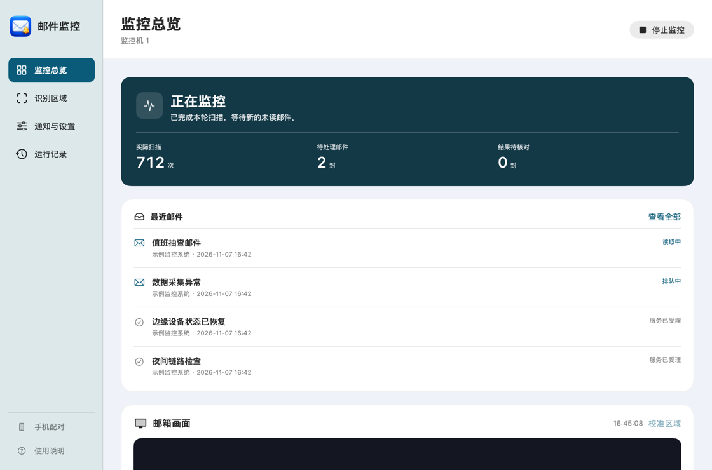

# 邮件监控 · Mail Alert Monitor

在电脑上看守远程邮箱，在安卓手机上查看监控状态。Mac 控制台把运行状态、待处理数量、最近邮件原主题和推送结果放在首页。Windows 可框选邮件列表和阅读区，自动处理未读邮件。

## 下载

| 平台 | 下载 | 首次打开 |
| --- | --- | --- |
| macOS 14 及以上，Intel 或 Apple 芯片 | [Mac 通用版 ZIP](https://github.com/19939138357/mail-alert-monitor/releases/download/v1.4.0/MailAlertMonitor-macOS.zip) | 解压，把两个 App 放在同一文件夹，打开「抽查邮件监控开源版」 |
| Windows 10 / 11，.NET Framework 4.8 | [Windows 便携版 ZIP](https://github.com/19939138357/mail-alert-monitor/releases/download/v1.4.0/MailAlertMonitor-Windows.zip) | 将整个 ZIP 解压到自己的可写文件夹，双击 `MailAlertMonitor.exe` |
| 安卓 8 及以上 | [「监控机 1」APK](https://github.com/19939138357/mail-alert-monitor/releases/download/v1.4.0/MailAlertMonitor-Android.apk) | 在手机上安装，打开「配对电脑」，输入 Mac 上显示的六位码 |

[版本说明及 SHA-256 校验文件](https://github.com/19939138357/mail-alert-monitor/releases/tag/v1.4.0) · [MIT 许可证](LICENSE)

## Mac 上监控未读邮件

1. 在 Safari 中打开自己有权访问的 HTTPS 远程 Foxmail 页面。保持邮箱可见，按「是否已读」排序，展开未读、收起已读。
2. 打开「抽查邮件监控开源版」，点「选择邮箱窗口」，预览后在 Mac 上确认这个页面。按提示授予录屏、辅助功能权限。用「识别区域」框选邮件列表和正文。
3. 在「通知与设置」填自己的 PushPlus Token，点「测试微信」核对收件，然后点「开始监控」。
4. 首页可以区分邮件正在读取、排队、服务已受理和待核对。程序在点击前保存整批候选，核对正文后按原主题提交。对结果不确定的邮件保留记录，供人工核对。

下载的 Mac 工具使用本地签名，未通过 Apple 公证。主监控使用系统组件。另开「手机配对」时需要本机可运行 Python 3.8 或更高版本。特定门户的一键登录和断线重连需按自己的系统做适配；已适配门户也可能遇到远程空白页或重连延迟。[Mac 使用说明](macos/使用说明.txt) · [门户适配](docs/PORTAL_ADAPTER.md)

## Windows 上开始监控

1. 将整个 ZIP 解压到可写文件夹，双击 `MailAlertMonitor.exe`。在「监控设置」里选「Foxmail 未读邮件正文」，填能唯一识别邮箱的窗口标题。
2. 让邮箱处于前台，展开右侧的详细邮件头。用鼠标分别框选带蓝点的邮件列表和完整阅读区，远程窗口需要把正文滚动条也框进去。
3. 在「通知设置」填自己的推送渠道，确认测试消息后再启动。新发现的未读邮件会先进入加密队列。程序按原主题发送已核对的正文，读不到末尾、身份不明或送达结果待查的邮件可以在「待核对邮件」查看。
4. 还可以选择「屏幕关键词」或「抽查邮件确认码」。中文邮箱需要 Windows 中文 OCR 语言包。远程画面中的短邮件如果没有可识别的滚动条，程序会保留待核对。[Windows 便携版指南](legacy/windows/PORTABLE.md)

## 安卓手机控制 Mac

两端连同一个 Wi-Fi。在 Mac 点「手机配对」并显示六位码，安卓「监控机 1」选电脑并输入六码。首页能看待处理数量、邮件原主题和推送状态。在 Mac 同意共享已确认的邮箱页面后，可以在手机查看和操作该页面。公开版首次授权或更换目标页面须在 Mac 完成。安卓当前的配对主机为 Mac；Windows 可以通过自己的通知通道发送提醒。[安卓配对和构建说明](handset/README.md)

## 数据与运行条件

屏幕 OCR 在电脑本地运行，使用者的队列和近期记录可能包含邮件正文。配置手机推送后，选定渠道会收到对应邮件内容。Mac 开源版的数据和钥匙串标识与已有私人安装版分开。Windows 解压目录在使用后会含个人设置或运行记录。请只分享原始发布包。[隐私说明](docs/PRIVACY.md)

窗口被遮挡、系统睡眠、远程掉线或布局改变都可能影响识别。推送服务受理后，实际送达仍需在接收端核对。仅靠画面无法区分发件人、主题和时间完全相同的两封信。

## 源码与验证

| 目录 | 内容与构建 |
| --- | --- |
| [macos](macos) | 在 Mac 运行 `bash macos/build.sh`，生成通用主程序并进行本机自测 |
| [handset](handset) | 安卓控制端与 Mac 配对桥。在 Mac 执行 `bash handset/mac/build-pair.sh`，再用 `bash macos/package-release.sh` 组合两个 App |
| [legacy/windows](legacy/windows) | Windows OCR、WinForms 控制台、手机通知及合成测试。运行 `python legacy/windows/package.py` 生成便携包 |
| [browser-extension](browser-extension) | 可选的 Chromium 邮件页面监控扩展 |
| [android-alarm](android-alarm) | 独立的安卓通知响铃助手源码，与上方「监控机 1」控制端分开 |

公开样本全部采用合成内容。仓库附有构建与发布流程，Android 正式签名私钥由维护者保管。自有源码使用 MIT 许可证，第三方组件按各自条款分发。[验证说明](docs/VALIDATION.md) · [第三方许可](THIRD_PARTY_NOTICES.md)
